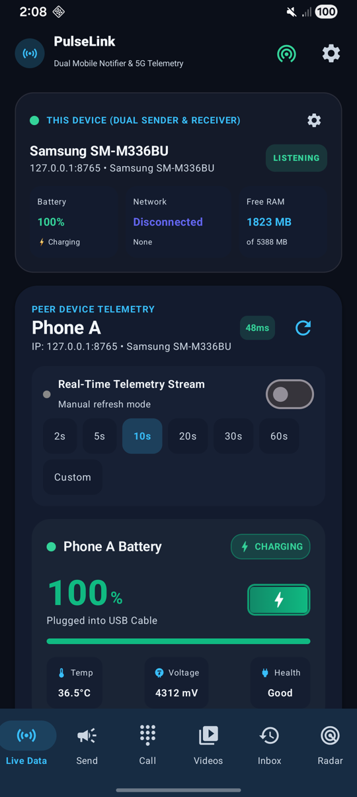
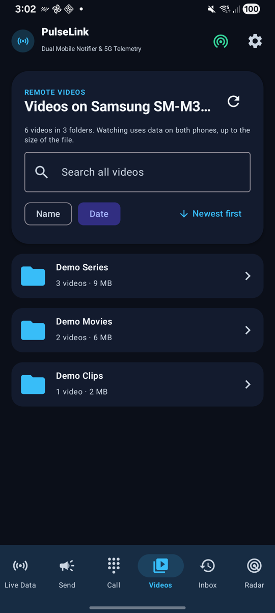
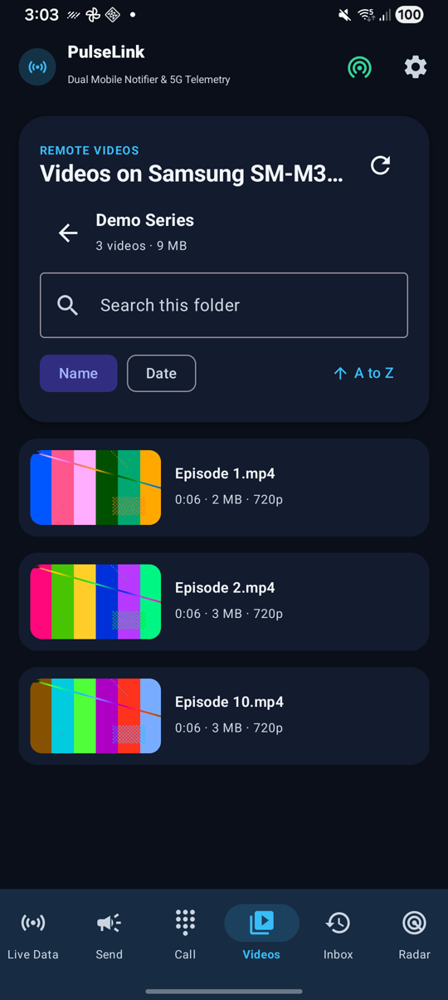
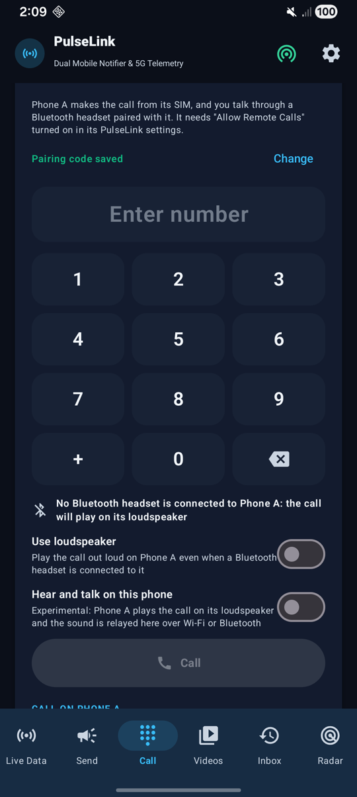
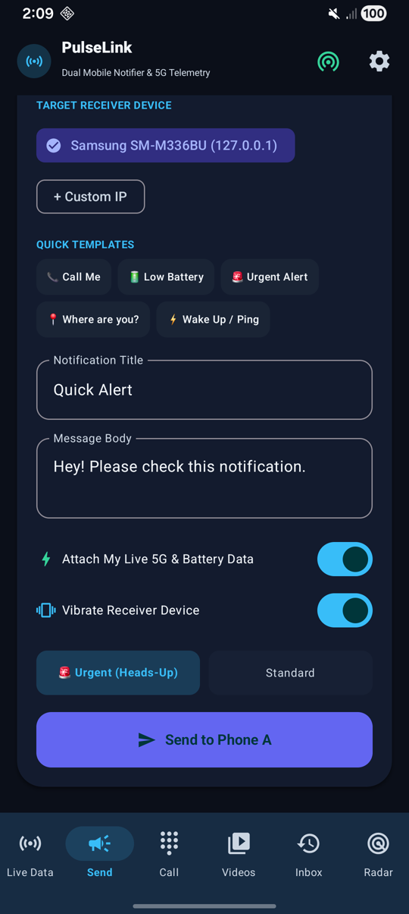
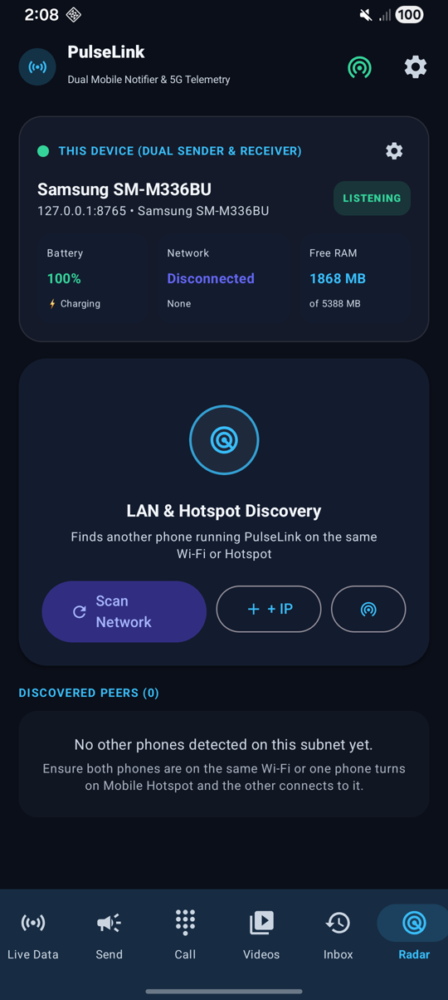
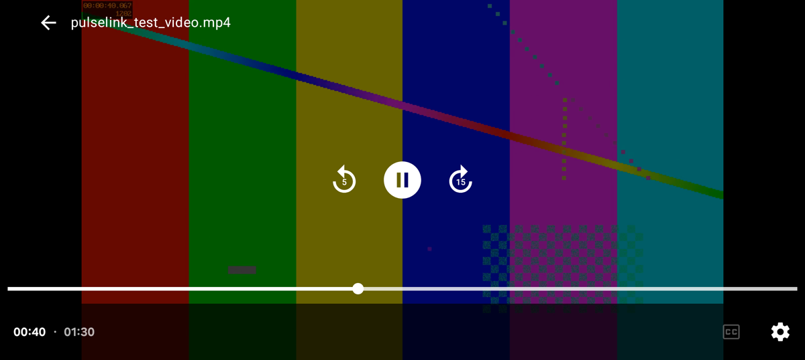

# PulseLink

**Use two Android phones as one.** See your main phone's messages and calls on your second phone, reply to chats, make calls from your main phone's SIM, watch the videos stored on it, and check its battery and signal, all over your own Wi-Fi or hotspot. No PulseLink account, no PulseLink server, no sign-up. To use it when the phones are far apart, see [Watch from anywhere](#-watch-phone-as-videos-on-phone-b).

[](https://github.com/Akshay7623/PulseLink/releases/latest/download/PulseLink.apk)

**Download link:** https://github.com/Akshay7623/PulseLink/releases/latest/download/PulseLink.apk
(All versions: https://github.com/Akshay7623/PulseLink/releases)

---

## Screenshots

<table>
  <tr>
    <td align="center"><br><b>Live status</b></td>
    <td align="center"><br><b>Video folders on the other phone</b></td>
    <td align="center"><br><b>Sort by name or date</b></td>
  </tr>
  <tr>
    <td align="center"><br><b>Call from Phone A's SIM</b></td>
    <td align="center"><br><b>Send an alert</b></td>
    <td align="center"><br><b>Connect the phones</b></td>
  </tr>
</table>

<p align="center">
  <br>
  <b>Full-screen player, with skipping and resume</b> (showing a test video)
</p>

---

## What you can do

| Feature | What it means for you |
|---|---|
| 🔔 **See notifications from your other phone** | WhatsApp, SMS, calls and other app notifications from Phone A pop up on Phone B. |
| 💬 **Reply to chats** | Reply to a WhatsApp or SMS message on Phone A without picking it up. |
| 📞 **Make and answer calls remotely** | Dial a number on Phone B and the call goes out from Phone A's SIM. Answer or hang up Phone A's calls from Phone B. |
| 🎬 **Watch Phone A's videos** | Browse and play the movies and videos stored on Phone A from Phone B, without copying them first. |
| 🔋 **Live phone status** | See Phone A's battery %, charging, 5G/4G network, signal, free RAM and storage, updating live. |
| 📣 **Send alerts** | Send your own notification to the other phone, with sound and vibration. |
| 📍 **Find your phone** | Make the other phone ring or vibrate. |

In this guide:
- **Phone A** = your main phone (the one with the SIM card and the apps you want to see).
- **Phone B** = your second phone (the one you want to carry or keep on your desk).

---

## What you need

- **Two Android phones** running Android 7.0 or newer. iPhones are not supported.
- Both phones on the **same Wi-Fi**, **or** one phone's **mobile hotspot** turned on and the other phone connected to it.
- PulseLink installed on **both** phones.

> No internet is needed on the same network. The phones talk to each other directly, so your messages never leave your own network. Only if the phones are in different places do they need the internet and the free Tailscale app (see **Watch from anywhere** below).

---

## Step 1: Install the app (on both phones)

1. On the phone, open the **[download link](https://github.com/Akshay7623/PulseLink/releases/latest/download/PulseLink.apk)** in Chrome.
2. When the download finishes, tap **Open** (or find `PulseLink.apk` in your **Files / Downloads** app and tap it).
3. If Android asks to **allow installs from this source**, tap **Settings**, switch on **Allow from this source**, then go back.
4. Tap **Install**, then **Open**.
5. When PulseLink asks to **send you notifications**, tap **Allow**.

Repeat on the second phone.

### If Android warns you or blocks the install

PulseLink is not on the Play Store, so Android may be careful with it. That is normal for apps installed from a file.

- **"Unsafe app" / "Play Protect warning"**: tap **More details** → **Install anyway**.
- **"App blocked"** (common in India for apps that read notifications):
  1. Open the **Play Store** → tap your **profile picture** → **Play Protect** → the **⚙️ gear** at the top.
  2. Switch off **Scan apps with Play Protect** for now.
  3. Install PulseLink again.
  4. Go back and **switch Play Protect on again**.

---

## Step 2: Connect the two phones

1. Put both phones on the same Wi-Fi, **or** turn on **Mobile Hotspot** on one phone and connect the other phone to it.
   (Tap the **hotspot icon** at the top of PulseLink for a quick guide.)
2. Open PulseLink on **both** phones.
3. On **Phone B**, tap the **Radar** tab at the bottom → **Scan Network**.
4. Phone A appears in the list. Tap it.

That's it. The **Live Data** tab now shows Phone A's battery, network and more.

**Phone A not showing up?** Use its address instead:
1. On Phone A, look at the card at the top of the app. It shows an address like `192.168.1.5:8765`.
2. On Phone B, go to **Radar** → **Add IP**, type the numbers before the `:` (for example `192.168.1.5`), leave the port as `8765`, and tap **Connect & Fetch**.

Phone B remembers Phone A under **Saved & Past Devices**, so next time just tap it there.

---

## Step 3: Turn on the features you want

All settings are behind the **⚙️ gear icon** at the top right of the app.

### 🔔 See Phone A's notifications on Phone B

**On Phone A:**
1. Tap ⚙️ → switch on **Share My Notifications**.
2. Tap **Grant Notification Access**, find **PulseLink** in the list and switch it on.
3. Tap ⚙️ → switch on **Background Listener Service**, so it keeps working when the app is closed.
4. Tap **Save Changes**.

**On Phone B:**
1. Tap ⚙️ → switch on **Peer Notification Alerts** and **Background Listener Service** → **Save Changes**.
2. Make sure Phone A is connected (Step 2).

Now Phone A's notifications pop up on Phone B, and they also show in Phone B's **Live Data** tab.
- **Reply** to a chat: tap **Reply** on the notification, type, and send. The reply is sent from Phone A.
- **Clear** a notification on Phone B and it is cleared on Phone A too.

> **Android says "Restricted setting"?** Open your phone's **Settings → Apps → PulseLink**, tap the **⋮** menu at the top right, choose **Allow restricted settings**, then try again.

### 📞 Make and answer Phone A's calls from Phone B

**On Phone A:**
1. Tap ⚙️ → switch on **Allow Remote Calls**.
2. Tap **Allow** when Android asks for the **Phone** permission.
3. A **pairing code** appears below the switch (8 letters, like `ABCD-EFGH`). Keep this screen open.

**On Phone B:**
1. Go to the **Call** tab.
2. Next to "Pairing code needed", tap **Enter code**, type Phone A's code, and tap **Save**. You only do this once.
3. Type a number on the dial pad and tap **Call**. The call is made from Phone A's SIM.
4. When Phone A rings, tap **Answer** or **Hang up** on Phone B.

**How do I talk on the call?**
- **Best way:** pair your **Bluetooth earbuds with Phone A**. Phone A makes the call and you talk through the earbuds.
- **Without earbuds (experimental):** Phone A plays the call on its loudspeaker and PulseLink passes the sound to Phone B, so you can hear and talk on Phone B.
  1. On Phone A: ⚙️ → switch on **Relay Call Sound** → allow **Microphone**.
  2. Tap **Open Accessibility Settings**, choose **PulseLink** under **Installed apps** and switch it on. (Android mutes the microphone during calls otherwise. PulseLink does not read your screen.)
  3. On Phone B: **Call** tab → switch on **Hear and talk on this phone** → allow **Microphone**.
  4. Optional: pair the two phones with each other in Android's **Bluetooth** settings, then switch on **Use Bluetooth between the phones** on Phone B. The sound then goes over Bluetooth instead of Wi-Fi.

### 🎬 Watch Phone A's videos on Phone B

**On Phone A:**
1. Tap ⚙️ → switch on **Share My Videos** → tap **Allow** when Android asks for access to videos.
2. A **pairing code** appears below the switch. It is the same code used for calls.
3. Switch on **Background Listener Service**, so it keeps working when the app is closed.

**On Phone B:**
1. Connect to Phone A (Step 2) and open the **Videos** tab.
2. Tap **Enter code**, type Phone A's code, and tap **Save**. You only do this once.
3. Your videos appear in their **folders**. Tap a folder to open it, and tap a video to play it. Drag the bar to skip. Next time, it continues from where you stopped.
4. To change the order, tap **Name** or **Date**, then tap the arrow next to them to switch between **A to Z** and **Z to A**, or **Newest first** and **Oldest first**. PulseLink remembers your choice.
5. To find a video in any folder, type its name in the search box on the folder list.

**Watch from anywhere (phones in different places):**
1. Install the free **[Tailscale](https://tailscale.com/download)** app on both phones, sign in to the **same account** on both, and switch it on.
2. On Phone A: **Settings → Apps → PulseLink → Battery → Unrestricted**, and leave it connected to the internet, ideally on Wi-Fi and charging.
3. On Phone B, go to **Radar** → **Add IP** and type Phone A's `100.x.x.x` address from the Tailscale app. Leave the port as `8765`.

Good to know:
- Phone A must stay switched on and online. It sends the original file, so its upload speed must keep up with the video: about 2.5 Mbps for a 2 GB, 2-hour movie, and much more for 4K.
- A video can use up to its full file size in data on **each** phone. Avoid mobile data on Phone A unless your plan allows it.
- If a video plays with no sound or no picture, Phone B cannot decode that format. The message on screen tells you which.
- Android runs one VPN at a time, so Tailscale cannot run alongside another VPN.

### 🔋 Watch Phone A's battery and network live

On Phone B, open **Live Data**. Switch on **Real-Time Telemetry Stream** to keep it updating, and pick how often.
Use **Ring Phone**, **Buzz** or **Ping** to find Phone A or check it's reachable.

### 📣 Send your own notification

Go to **Send**, pick the phone, write a title and message (or tap a **Quick Template**), and tap **Send**. Choose **Urgent** to make it pop up on screen. Everything you send and receive is listed in the **Inbox** tab.

---

## Privacy and safety

- **Everything stays on your network.** PulseLink has no server and no account. The phones talk directly over your Wi-Fi or hotspot.
- **Use only your own Wi-Fi or hotspot** when **Share My Notifications** is on. Any phone running PulseLink on the same network can see Phone A's notifications, so **do not turn it on at public Wi-Fi** (cafés, offices, hotels, trains).
- **Calls and videos are protected by the pairing code.** Only a phone that has Phone A's pairing code can make or answer calls on it or watch its videos. Do not share the code with anyone.
- **Videos are not encrypted by PulseLink.** On your own Wi-Fi or hotspot that is usually fine, because they stay on your network. Tailscale encrypts everything between the phones. **Never open PulseLink's port to the internet on a router**, as other parts of the app, such as notifications, have no pairing code.
- Every permission is asked for only when you switch on the feature that needs it. Switch a feature off to stop it.

---

## Troubleshooting

**The phones can't find each other**
- Check both phones are on the **same** Wi-Fi network (not one on Wi-Fi and one on mobile data).
- Keep PulseLink open on both phones while you connect.
- Some Wi-Fi networks (guest, office, hotel) don't let phones see each other. Use one phone's **hotspot** instead.
- Connect with **Add IP** (see Step 2).

**Notifications stop when I close the app or lock the screen**
- Switch on **Background Listener Service** in ⚙️ on **both** phones.
- Stop Android from putting PulseLink to sleep: **Settings → Apps → PulseLink → Battery → Unrestricted** (on some phones: **No restrictions** or **Don't optimise**).

**Notification access or Accessibility says "Restricted setting"**
- **Settings → Apps → PulseLink → ⋮ → Allow restricted settings**, then try again.

**Calls don't work**
- On Phone A, check **Allow Remote Calls** is on and the **Phone** permission is allowed.
- On Phone B, check the pairing code in the **Call** tab matches the one shown on Phone A (tap **Change** to re-enter it).

**Videos don't load or keep stopping**
- On Phone A, check **Share My Videos** is on and the **Videos** permission is allowed.
- On Phone B, check the pairing code in the **Videos** tab matches the one shown on Phone A.
- If the phones are far apart, check **Tailscale** is switched on on both.
- A video that keeps pausing to load is too large for Phone A's upload speed. Try a smaller one, or move Phone A to faster Wi-Fi.

**The hotspot address changed**
- Addresses can change each time a hotspot is switched on. Tap **Scan Network** again, or remove the old phone from **Saved & Past Devices** and add it again.

---

## Updating the app

Download the new APK from the **[download link](https://github.com/Akshay7623/PulseLink/releases/latest/download/PulseLink.apk)** and install it over the old one. Your settings and saved phones are kept.
After updating, open ⚙️ and switch **Background Listener Service** on again.

Remove the app the normal way: long-press the PulseLink icon → **Uninstall**.

---

## For developers

PulseLink is a Kotlin + Jetpack Compose Android app (`app/`). Build the debug APK with Gradle:

```sh
gradle :app:assembleDebug
```

The APK is written to `app/build/outputs/apk/debug/app-debug.apk`. To publish a new download, attach it to a [GitHub release](https://github.com/Akshay7623/PulseLink/releases/new) under the name **`PulseLink.apk`**. The download link above always points to the newest release's `PulseLink.apk`.
